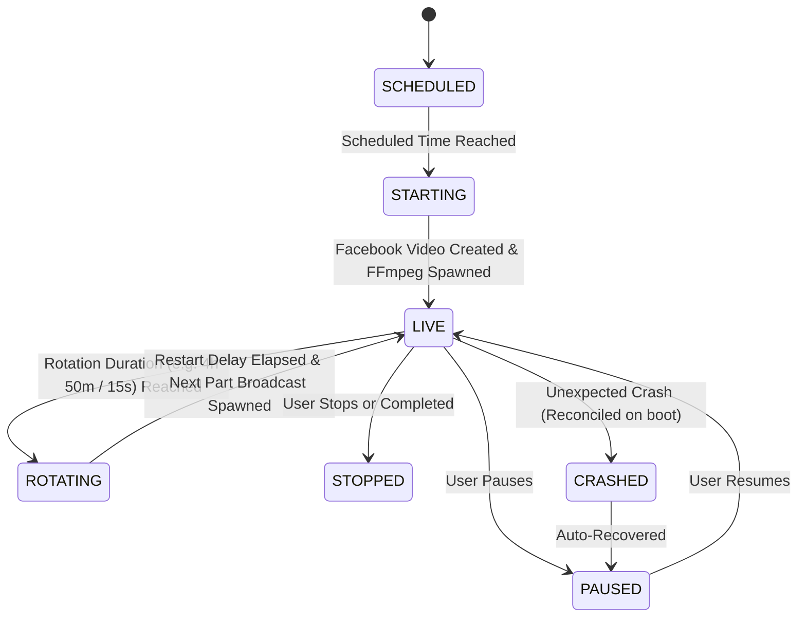

# Persistent Scheduler & Rotation Engine

## 1. Overview

Facebook enforces an 8-hour maximum continuous duration limit per live broadcast session. To maintain indefinite 24/7 streaming, our **Automated Rotation Engine** executes seamless rotations by stopping the old stream, terminating the Meta Live Video session, waiting an intentional restart delay, creating a new Live Video session with identical configurations, and resuming the stream under Rotation Part #2, #3, etc.

---

## 2. State Machine Transitions



---

## 3. Persistent Tick & Timing Algorithm

The scheduler tick runs at a configurable interval:
- **Test Mode**: `1000ms` tick interval, `15s` rotation duration, `3s` restart delay.
- **Production Mode**: `5000ms` tick interval, `17400s` (4h 50m) rotation duration, `60s` restart delay.

### Rotation Algorithm:
1. When an automation transitions to `LIVE`, `nextRotationScheduledAt` is calculated as `actualStartTime + rotationDurationSec`.
2. On every tick, the scheduler queries:
   ```javascript
   const liveAutomations = await Automation.find({
     status: 'LIVE',
     nextRotationScheduledAt: { $lte: new Date() }
   });
   ```
3. When triggered:
   - Gracefully terminates FFmpeg stream (`SIGTERM`).
   - Calls Meta Graph API: `POST /{live_video_id}?end_live_video=true`.
   - Records `Broadcast` as `ENDED` with total duration in seconds.
   - Sets `Automation.status = 'ROTATING'`.
   - Sets `nextRotationScheduledAt = now + restartDelaySec`.
4. When restart delay expires:
   - Increments `currentRotationIndex = currentRotationIndex + 1`.
   - Creates new Meta Live Broadcast ID on the same Page.
   - Spawns FFmpeg stream with identical media.
   - Transitions back to `LIVE`.

---

## 4. Startup Crash Reconciliation

If the backend server experiences an unexpected reboot or power outage:
1. `schedulerService.reconcileStartupState()` runs before the scheduler tick loop starts.
2. Queries all automations with status `LIVE` or `ROTATING`.
3. Validates whether the tracked OS child process PID is still running on the system (`process.kill(pid, 0)`).
4. For dead processes:
   - Marks orphaned `Broadcast` and `StreamProcess` records as `CRASHED` with timestamp and error message.
   - Resets `Automation` status to `PAUSED` with warning flag.
   - Prevents ghost live streams on Facebook and prevents duplicate stream spawns.
